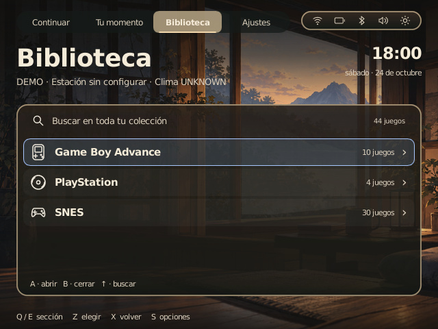
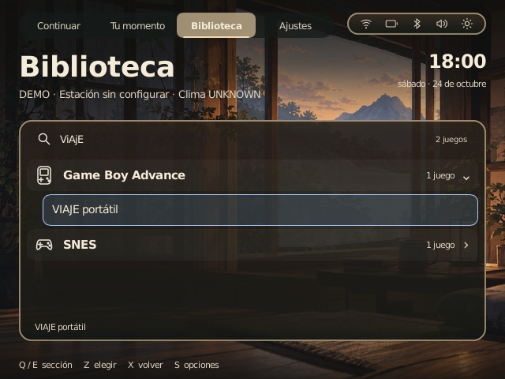
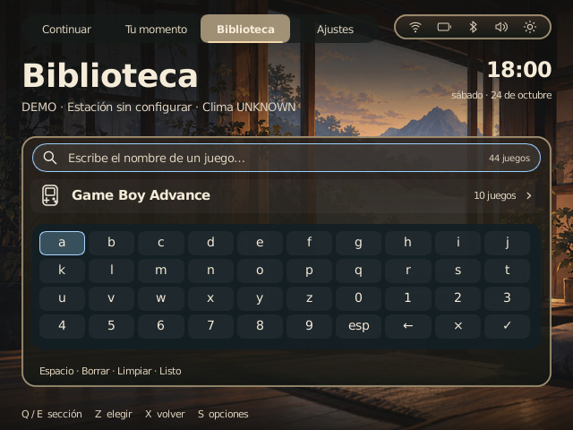
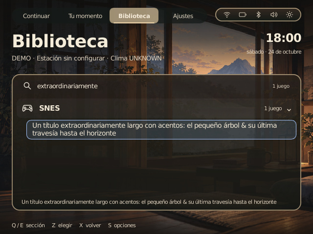

# Library by system

The Library now groups the existing imported collection by system. Each header shows an icon, a system name, the number of available games and an expansion indicator. One system can be expanded at a time. System and game selection use the same turquoise/blue/violet focus palette as the approved game cards, with a transparent interior and a prepared antialiased contour.

- D-pad/joystick: move through systems and games; **A** expands a header or selects a game. Right opens a system, left closes it.
- **B** closes the keyboard, then the expanded system, then clears a search, then returns to the previous section. Reopening a system and moving down recalls its previous selected game.
- Move up from the first row to the search button; A opens the integrated keyboard. It works with buttons and touch. Physical text input, Backspace and Enter also work through Slint. Native keyboard/controller coexistence still needs a device check.
- Touch a system to expand it, touch a game to select it, and drag the list to scroll. The row title wraps; its full name is repeated in the lower reading area.

Search filters titles across all systems as text is entered, ignoring case and common accented Latin vowels. Counts reflect the filtered results. Empty results offer a friendly message.

## Existing integration

SQLite and the existing importer remain the collection source. System keys come from imported gamelist locations under the authorized library root, including a symlinked root. Unknown systems retain their detected folder label; records without a reliable system use “Colección”. Missing/unavailable games do not create groups. Folders without an imported gamelist are subject to the existing importer's limitations; no new ROM scanner or scraper is added.

Lowercase title keys and system groups are built when the catalog changes. Typing filters this in-memory index: no filesystem walk, SQLite query, image decoding or network request occurs per keystroke. Slint ListView virtualizes the visible rows; the UI model changes only when the view changes. Row appearance is a finite 130 ms animation, disabled by reduced motion.

A game row resolves to its original catalog entry and uses the existing launcher/supervisor. Trial mode still blocks game launching. The console, boot setup, network, system control center, ROMs, BIOS and saves are untouched.

## Review captures

These are JPEG exports of actual 640×480 Slint software captures with owned synthetic **test fixtures**, not a real collection or a physical screen. Raw PNGs are reproducible with the replay tool. The public images below precede the turquoise/blue/violet focus follow-up; its new captures were verified privately and are not uploaded.

This PR starts from published main. Earlier unpublished local visual/system changes remain separate; shared styles are reused so the Library can inherit them when integrated.
